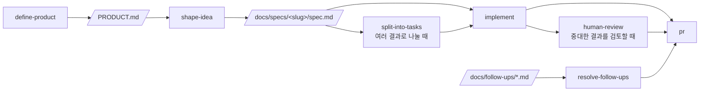

# 끝말잇기: 이기면서 배우는 AI 끝말잇기

[](https://www.claude-hunt.com)
[](https://docs.claude-hunt.com)

초등학생이 AI와 끝말잇기를 하면서 **표준어와 그 뜻을 자연스럽게 익히는** 웹 앱입니다.

로블록스 끝말잇기는 표준어가 아닌 이상한 단어도 통해서, 아이가 단어는 외우는데 뜻은 모릅니다. 이 앱은 표준어만 통하게 하고, 단어를 낸 바로 그 화면에서 뜻과 그림을 보여 줍니다. 이기려고 하다 보면 단어와 뜻이 함께 남는 것이 목표입니다.


## 주요 기능

- **AI와 한 판:** 닉네임을 입력하고 AI와 번갈아 단어를 잇습니다. 차례마다 30초 안에, 기회 4번 안에 맞는 단어를 내야 합니다.
- **낼 때마다 뜻 보기:** 내가 낸 단어와 AI가 낸 단어의 이모지, 뜻, 예문이 같은 화면에 바로 나옵니다.
- **두음법칙:** "리"로 끝나면 "이"로도 이을 수 있고, 가능할 때는 "두음법칙 적용 가능!" 힌트가 나옵니다.
- **끝장단어:** 상대가 이을 수 없는 단어를 내면 그 즉시 이깁니다. 첫 단어에는 쓸 수 없습니다.
- **힌트 도우미:** 막히면 한 판에 3번까지 열 수 있는 옆면 도우미에서 이어 갈 단어와 끝장단어(🔥 표시)를 보고 뜻을 확인합니다.
- **사전 확인:** 단어장에 없는 단어를 입력하면 서버가 [표준국어대사전](https://stdict.korean.go.kr/)에서 표준어(명사)인지 확인하고, 맞으면 사전 뜻풀이로 판에 넣습니다. 철자가 같은 단어는 뜻을 최대 3개까지 번호로 보여 줍니다.
- **승패 기록:** 닉네임별 승패가 이 기기의 브라우저에 쌓입니다. 가입이나 서버 저장이 없습니다.

| 사전에서 확인된 단어 | 결과 화면(뜻이 여러 개인 단어) | 모바일 |
|---|---|---|
|  |  |  |

## 기술 스택

Next.js 16 (App Router) · React 19 · Tailwind CSS 4 · shadcn/ui · Bun · Vitest · Playwright

## 시작하기

```bash
bun install
bun dev
```

[http://localhost:3000](http://localhost:3000)에서 확인합니다. 사전 확인 기능을 쓰려면 [표준국어대사전 Open API](https://stdict.korean.go.kr/openapi/openApiInfo.do) 인증 키가 필요합니다. 프로젝트 루트에 `.env.local` 파일을 만들고 키를 넣으세요.

```
STDICT_API_KEY=발급받은_32자리_키
```

- 키는 서버에서만 읽고 브라우저로 보내지 않습니다. `NEXT_PUBLIC_`을 붙이지 마세요.
- **키가 없어도 앱은 실행됩니다.** 직접 쓴 단어장으로 게임을 끝까지 할 수 있고, 단어장에 없는 단어를 입력하면 "사전에 연결하지 못했어요"가 나옵니다.
- 배포할 때는 호스팅 서비스의 환경 변수에 같은 이름으로 넣습니다.

## 스크립트

| 명령어 | 설명 |
|---|---|
| `bun dev` | 개발 서버 실행 |
| `bun run build` | 프로덕션 빌드 |
| `bun start` | 프로덕션 서버 실행 |
| `bun run lint` | ESLint 실행 |
| `bun run typecheck` | `tsc --noEmit` 타입 검사 |
| `bun run test` | Vitest 단위/컴포넌트 테스트 1회 실행 |
| `bun run test:watch` | Vitest watch 모드 |
| `bun run test:e2e` | Playwright E2E 테스트 실행 |

## 구조

- `features/wordchain/`: 끝말잇기의 모든 코드가 있습니다. 규칙(`game.ts`), 단어장(`words.ts`), 승패 기록(`records.ts`), 화면 컴포넌트, 사전 확인(`dictionary.ts`, 서버 전용 `server.ts`)으로 나뉩니다. 공개 API는 `index.ts`입니다.
- `app/api/word-check/`: 브라우저가 부르는 사전 확인 경로입니다. 인증 키는 여기서만 쓰입니다.
- `PRODUCT.md`: 이 앱이 누구를 위해 무엇을 약속하는지 적은 제품 정의입니다.
- `docs/specs/`: 기능별 스펙(`ai-wordchain-round`, `dictionary-word-check`, `hint-helper`)입니다.
- `docs/decisions/`: 단어 출처와 UI 구성의 결정과 근거입니다. 어떤 사전을 검토했고 왜 이렇게 정했는지 남아 있습니다.
- `GLOSSARY.md`: 판, 차례, 기회, 끝장단어 같은 용어집입니다.

## 단어 출처와 라이선스

- AI가 낼 단어와 기본 뜻 카드는 앱에 포함된 **직접 쓴 단어장**(표준어 355개, 초등학생 눈높이의 뜻풀이, 예문, 이모지)에서 가져옵니다.
- 아이가 입력한 단어가 단어장에 없으면 [국립국어원 표준국어대사전](https://stdict.korean.go.kr/)의 뜻풀이를 씁니다. 이 자료는 [크리에이티브 커먼즈 저작자표시-동일조건변경허락 2.0 대한민국 라이선스(CC BY-SA 2.0 KR)](https://creativecommons.org/licenses/by-sa/2.0/kr/)로 제공되며, 모든 화면 아래에 출처를 표시합니다. 사전 응답은 파일이나 단어장에 저장하지 않고 서버 메모리에만 잠시 기억합니다.

## 알려진 한계

- 사전에서 가져온 뜻풀이는 어른 눈높이라 길거나 어려울 수 있습니다.
- 철자가 같은 단어의 뜻을 사전 순서대로 3개 보여 주기 때문에, 흔한 뜻이 3개 안에 없거나 아이에게 적당하지 않은 뜻이 보일 수 있습니다. 흔한 단어는 단어장에 직접 쓴 뜻이 있어 영향이 작습니다.
- 단어장이 작아서(355개) 판이 짧고, 이어 갈 단어가 거의 없는 글자가 있습니다.
- 승패 기록은 브라우저에만 저장되어 다른 기기와 공유되지 않고, 저장 데이터를 지우면 사라집니다.
- 초대 링크 대전과 표준어 제안 기능은 아직 없습니다.

## 테스트

- **단위·컴포넌트**: Vitest + Testing Library. 설정은 `vitest.config.mts`, 매처와 cleanup은 `vitest.setup.ts`에 있습니다. 테스트 파일은 소스 옆에 `*.test.ts(x)`로 둡니다. `globals`를 켜지 않았으므로 `describe`/`it`/`expect`는 `vitest`에서 import 합니다.
- **E2E**: Playwright. 설정은 `playwright.config.ts`, 테스트는 `e2e/*.spec.ts`에 둡니다. `webServer`가 `bun run dev`를 자동으로 띄우므로 별도 서버 실행이 필요 없습니다.

E2E를 처음 실행하기 전에 브라우저를 한 번 내려받아야 합니다.

```bash
bunx playwright install chromium
```

브라우저가 이미 설치된 환경(예: Claude Code 원격 세션)에서는 내려받는 대신 실행 파일 경로를 지정할 수 있습니다.

```bash
PLAYWRIGHT_CHROMIUM_PATH=/opt/pw-browsers/chromium bun run test:e2e
```

`async` Server Component는 Vitest가 아직 지원하지 않으므로 E2E로 검증합니다.

- **런타임 검증(에이전트용)**: [agent-browser](https://github.com/vercel-labs/agent-browser). 에이전트가 `next-dev-loop` 스킬로 실행 중인 앱을 직접 조작해 변경을 확인할 때 씁니다. 프로젝트 의존성이 아니므로 한 번 전역으로 설치합니다.

```bash
npm i -g agent-browser
agent-browser install  # 설치된 Chrome이 없을 때만
```

## Claude Code 워크플로우

이 앱은 아래 흐름으로 만들었습니다. 제품 정의에서 시작해 기능마다 스펙을 정하고, 구현과 검증, PR까지 이어집니다.



파이프라인 밖에서는 `project-knowledge`, `maintain-project-context`, `add-stack-context`, `build-prototype`, `explain-visually`, `tdd`가 각자의 조건에 따라 켜집니다. `project-knowledge`는 `GLOSSARY.md`, `docs/decisions/`, `docs/follow-ups/`에 다음 작업에서도 재사용할 지식과 후속 항목을 남깁니다. Git 작업은 `commit`, `pull`, `push`, `pr`, `merge`가 해당 요청에 맞춰 처리합니다.
